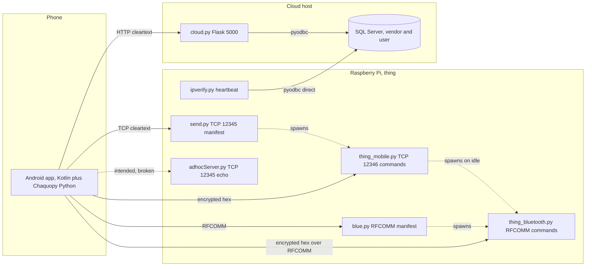

Status: RESEARCH, not a design ruling. Sources read: `A_novel_IoT-device_management_platform_for_on-the- (1) (1).pdf` (all 28 pages of text, figures 3 to 8 viewed), `TIH_IoT Project Documentation.docx.pdf` (text, figures 9 and 10 viewed), `Android_code_documentation.pdf`, `Android UI Screenshots.pdf`, every non-generated Kotlin, Python, layout and grammar file on `oneiot-study/filelist.txt`, `Untitled Document 1`, class and method names of `app/py311/release/app-py311-release.apk` (no strings, resources or assets).

# 02: What OneIoT is

Paths are relative to `/media/sandesh/extra-ssd/AndroidWork/OneIOTApp`. `K/` means `app/src/main/java/com/example/iot1/`. Tags: VERIFIED (source) read in code, VERIFIED (APK) from dex names, INFERRED, DOCS-ONLY, EXTERNAL.

## 1. The short version

The paper describes a general platform: a device carries a JSON manifest written to a formal grammar, a single phone app downloads it and builds a UI, and a five-phase protocol carries commands and readings.

The code is a smaller thing: an air conditioner demo. It proves the idea of drawing controls from JSON, for one manifest shape, and sends commands one way. It has no runtime grammar, no reading path from device to app, and no device-unique manifest.

| Claim in the study brief | Finding | Evidence | Tag |
|---|---|---|---|
| App interprets the manifest through a dictionary | No dictionary at runtime. A hand-written key classifier picks one of 6 layouts. | `K/DisplayThingActivity.kt:165-190,199-309` | VERIFIED (source) |
| Each device ships a unique manifest | Every device running these scripts sends the same `ac.json` from a fixed path. | `send.py:72` | VERIFIED (source) |
| Pi program produces readings that reach the app | No such code. Pi scripts decrypt, print and send an ACK. | `thing_mobile.py:47-104` | VERIFIED (source) |
| Reading file (txt) is sent to the app | No script writes or sends any reading file. | section 7 of this memo | VERIFIED (source) |
| Send button, tabs BP, SpO2, Thermometer | Not present. These are the operator's proposal for later work. | whole app | VERIFIED (source) |

## 2. Story from start to end, as the code runs

1. **Pi start.** An operator starts scripts by hand. There are no service units and no shebang lines (`01-inventory.md` section 8). `ipverify.py:50-59` loops every 5 s, finding the Pi's IP and writing it straight into the `vendor` table of SQL Server. That is the "heartbeat".
2. **Phone start.** `CheckActivity` is the launcher (`app/src/main/AndroidManifest.xml:49-56`). With internet it opens `MainActivity` (login). Without internet it asks for Bluetooth and opens `BluetoothMainScreen`. If Bluetooth enable is refused it opens `Adhoc` (`K/CheckActivity.kt:28-32,77-93`).
3. **Register.** `RegisterActivity` collects name, email, mobile, Thing ID and password. It shows the "OTP" in a toast and compares locally (`K/RegisterActivity.kt:150-156,67-69`). It posts to `/register_user`, without the password (`K/RegisterActivity.kt:94-96`), and saves SHA-256 hashes in EncryptedSharedPreferences (`K/RegisterActivity.kt:122-141`).
4. **Login.** `MainActivity` posts to `/validate_user`. `cloud.py` has no such route (`cloud.py:72,120,173`), so the app falls to the offline check (`K/MainActivity.kt:74-77`). A plain boolean then keeps the user logged in for good, with no logout path (`K/MainActivity.kt:109-118`).
5. **Add device.** `ThingDetailsActivity` takes Thing name, ID and key. Vendor choices are hardcoded placeholders (`K/ThingDetailsActivity.kt:63`). After a local toast OTP it posts `/register_thing` (`K/ThingDetailsActivity.kt:128`).
6. **Find the device.** The app calls `/get_user_ip?thingId=...`, gets `thingIp` and stores it once in SQLite (`K/ThingDetailsActivity.kt:169-176`, `K/DBHelper.kt:36-50`). There is no scan. Discovery means "ask the cloud".
7. **Manifest.** The app opens TCP 12345, sends `'send_file',<phone ip>:<md5>@<hardcoded phone public key>` in cleartext (`K/ThingDetailsActivity.kt:205-215`). `send.py` replies with the bytes of `ac.json` then the Pi's public key, then closes (`send.py:72-80,88`). The app reads to EOF, saves one file, then splits at the text `ssh-rsa` (`K/ThingDetailsActivity.kt:222-250`).
8. **UI.** Tapping any saved Thing opens `DisplayThingActivity`, which always loads the one `manifest.json` (`K/DisplayThingActivity.kt:83`), whichever Thing was tapped. It walks the JSON, classifies keys, and inflates `xml1` to `xml6` (`K/DisplayThingActivity.kt:199-309`).
9. **Command.** Tapping + or - on a range, or choosing a mode, runs `sendToRpi` (`K/DisplayThingActivity.kt:244,356,366`). The value is wrapped, hashed with MD5, RSA-encrypted through Chaquopy Python, and written to TCP 12346 (`K/DisplayThingActivity.kt:492-512`).
10. **Device reaction.** `thing_mobile.py` decrypts, checks MD5, prints, and replies with an encrypted `ACK` (`thing_mobile.py:47-104`). No actuator or sensor is touched.
11. **Data in the app.** Nothing is received except the ACK. It only affects log lines and the retry decision (`K/DisplayThingActivity.kt:518-525`). Nothing is stored, shown or exported.

## 3. Paper summary (paraphrased)

- **Problem.** One phone app per IoT device wastes storage and battery and widens attack surface (paper abstract, p.1 to 2).
- **Contribution.** A manifest-file approach, a manifest grammar, an application-layer protocol, one control app (p.2).
- **Architecture.** IoT node, remote host (cloud), user agent. The paper announces "four types" of building block and lists three (p.6).
- **Protocol.** Phases Discovery, Registration, Probe/Advertisement, Invocation, Configuration (p.7 to 9). Header carries protocol name, version and encryption type. Request payload carries protocol name, operation name and arguments. Response payload carries outputs (Figs 3 to 5, p.8). Invoke has GET on sensor or actuator and SET on actuator (Fig 8, p.12).
- **Manifest.** Main manifest (mandatory, read-only) and sub manifest (optional, user modes and location). Sensor values are read-only; actuators can be set (p.11 to 12).
- **Grammar.** A 4-tuple (V, T, P, S) with productions on p.13 to 15, plus Algorithm 1 that walks a parse tree to emit JSON (p.15).
- **Evaluation.** A simulation on one machine (Python, Twisted, Kivy), then a real setup: Samsung phone, Raspberry Pi 400, Ubuntu cloud server (p.19 to 22). The evaluation is a demonstration. It reports no measured results, no conformance test, no user study.
- **Stated limits and future work.** Encryption of the manifest is optional and left for later; CoAP is named as a possible swap for TCP (p.3, p.24). Medical devices are mentioned only as an applicable domain (p.3).

## 4. Glossary

| Term | Meaning | Source |
|---|---|---|
| Thing | The IoT device, in code and project doc | `K/Thing.kt:10`, TIH 6.1 |
| ICA | IoT-device control app (the phone app) | paper p.1 |
| OneIoT, Open OneIoT, O2IoT, OOneIoT-App, One-IoT, IOT1 | Names for the same work. `IOT1` is the Gradle project, `One-IoT` the app label | paper p.6, p.22, p.24; `settings.gradle.kts:22`; `app/src/main/res/values/strings.xml:4` |
| MMF, SMF | Main manifest file, sub manifest file | paper p.11 to 12 |
| Thing ID, TID | Device identifier given by the OEM | TIH 6.1.1 |
| Thing Key, tkey | Shared secret given by the OEM | TIH 6.2.2, paper Fig 7 |
| vendor, user | SQL Server tables on the cloud side | `cloud.py:48,55` |
| Remote host, cloud node, OEM server | `cloud.py` plus SQL Server | paper p.6 |
| Heartbeat, tick rate | Paper: periodic device ping. Code: `ipverify.py` writing to the DB | paper p.23; `ipverify.py:50-59` |
| Probe, Invoke | Protocol phases. Only `air_conditioner.py` matches these words | `air_conditioner.py:20,23` |
| PREA | Proposed Reference Edge Architecture | TIH section 2 |
| Adhoc | Direct TCP to a fixed `192.168.4.1`; see `05` | `K/Adhoc.kt:340` |

## 5. Deployment map (R0-6f)

| Script | Runs on | Evidence | Status | Tag |
|---|---|---|---|---|
| `send.py` | Pi | `/home/veman/Desktop` paths, spawns `thing_mobile.py` (`send.py:41,90`) | Live | VERIFIED (source) |
| `thing_mobile.py` | Pi | Port 12346 is what the app dials (`thing_mobile.py:19`, `K/DisplayThingActivity.kt:379`) | Live | VERIFIED (source) |
| `blue.py` | Pi | RFCOMM server, spawns `thing_bluetooth.py` (`blue.py:18,82`) | Live | VERIFIED (source) |
| `thing_bluetooth.py` | Pi | Spawned by two scripts above; UUID matches app (`thing_bluetooth.py:22`) | Live | VERIFIED (source) |
| `ipverify.py` | Pi | Reports its own WLAN IP to the DB (`ipverify.py:10-16,36-41`) | Live | VERIFIED (source) |
| `decryptMessage_test.py`, `encryptMessage_test.py` | Pi | Libraries despite their names (`thing_mobile.py:4-5`) | Live | VERIFIED (source) |
| `adhocServer.py` | Pi, as hotspot host | Binds 12345, plain echo (`adhocServer.py:4-5,26`) | Demo, does not match app format | INFERRED |
| `thing_mobile_bluetooth.py` | Pi | Older variant on fixed channel 1, nothing spawns it | Dead | INFERRED |
| `cloud.py` | Cloud host | Flask on 0.0.0.0:5000 (`cloud.py:218`) | Live | VERIFIED (source) |
| `air_conditioner.py` | Laptop | Kivy window, port 8004, the paper's simulated device (`air_conditioner.py:11,48`) | Simulation only | INFERRED |
| `encrypter.py`, `decrypter.py` | Laptop to Pi | Interactive pair on port 65432 (`encrypter.py:27-28,36`, `decrypter.py:29`) | Crypto experiment | INFERRED |
| `output.py`, `fetch.py`, `kotlintopython.py` | Laptop | Prototypes of the classifier with inline AC JSON | Dead | INFERRED |
| `grammar_parser.py` | Laptop | Arithmetic demo only (`grammar_parser.py:4,36`) | Dead | VERIFIED (source) |
| `IPLocation.py` | Laptop | One lookup of a hardcoded IPv6 at ipinfo.io (`IPLocation.py:3-4`) | Dead | VERIFIED (source) |

Files the Pi scripts need but this folder lacks: `bluetooth_address.txt`, `ip_address.txt`, `Thing_IP.txt`, `MobilePublicKey.txt`, `ThingPublicKey.txt`, `credentials.txt` (VERIFIED absent). The Pi cannot run from this folder as it stands. `send.py:59` and `send.py:41` create two of them; nothing here creates `bluetooth_address.txt` or `Thing_IP.txt` (VERIFIED by search over the file list).

## 6. APK vs source (R0-5)

The APK is `py311Release`, version 1.0 (`app/py311/release/output-metadata.json:7-16`). Only class and method names were listed.

| Question | APK | Source | Tag |
|---|---|---|---|
| `grammarMap` or `GrammarRule` compiled in | No class or method with those names, 0 of 13336 classes match `grammar` | Rules file sits outside the source set and cannot compile (`android_grammer_rules:395-396`) | VERIFIED (APK), VERIFIED (source) |
| Activities | Adhoc, AvailableThings, BluetoothDisplayThing, BluetoothMainScreen, Check, DisplayThing, Main, Register, ThingDetails | Same 9 (`app/src/main/AndroidManifest.xml:36-81`) | VERIFIED (APK), VERIFIED (source) |
| JDBC classes ship | Yes: `com/mysql` 1323, `com/microsoft/sqlserver` 419, `net/sourceforge/jtds` 86 | Declared at `app/build.gradle.kts:75,76,81` | VERIFIED (APK), VERIFIED (source) |
| App code calls JDBC | 0 invoke references from `com/example/iot1` classes | No `java.sql`, `DriverManager`, `Class.forName` or `jdbc:` URL in Kotlin | VERIFIED (APK), VERIFIED (source) |
| `DisplayThingActivity` | Has `connectToDevice`, `isNetworkAvailable`. Lacks `handleAcknowledgment`, `setupBluetooth`, `checkBluetoothPermissions`, `connectToBluetoothDevice`, `registerBluetoothReceiver` | The reverse | VERIFIED (APK), VERIFIED (source) |
| `BluetoothMainScreen` | Lacks `SplitFiles`, `generateChecksum`, `arePermissionsGranted`, `requestBluetoothPermissions`, `registerBluetoothReceiver` | Has all of them | VERIFIED (APK), VERIFIED (source) |
| `MainActivity` | Lacks `saveLoginState`, `isLoggedIn` | Has both | VERIFIED (APK), VERIFIED (source) |
| `ThingDetailsActivity` | Has field `raspberryPiIp` | Local variable only | VERIFIED (APK), VERIFIED (source) |

**Conclusion (INFERRED).** The APK was built from an older revision than this source, so it cannot stand as ground truth for current behaviour. It does settle two points: the grammar was not compiled in that revision, and neither was JDBC ever called from app classes in it.

## 7. Direct answers to R0-6

**a. Grammar at runtime, and picking a layout.** Design-only. No Kotlin or Python file references `grammarMap`, `GrammarRule`, `grammar.txt` or lark outside their own files (VERIFIED, search over the file list). `android_grammer_rules` is outside the source set, has a missing comma (`android_grammer_rules:395-396`), duplicate map keys (`:195,365,396`, `:199,403`, `:115,267`), and references layouts that do not exist (`R.layout.str_layout` at `:52`; `res/layout` has none). A manifest picks a layout through key names only: `classifyValue` (`K/DisplayThingActivity.kt:165-190`) feeds `addUIElements` (`:220-291`). The full table is in `04-ui-generator.md`. Runtime leftovers of the grammar: `validEndKeywords` only filters a log loop (`:142-147`), `rangeCategories` is matched by array length only (`:169`).

**b. `grammar.txt` and lark.** `grammar.txt` is the paper's CFG as text (`grammar.txt:1-78`). `grammar_parser.py` does not validate manifests: it loads `testingGrammer.txt` and evaluates one arithmetic string (`grammar_parser.py:4,8,36-47`). Lark runs nowhere in the product: Chaquopy installs only `cryptography` (`app/build.gradle.kts:63-65`), and no Pi or cloud script imports it. The paper's "MMF-generation-tool" (p.15) is not in this folder (DOCS-ONLY).

**c. Bluetooth.** Bluetooth Classic RFCOMM on both sides; PyBluez on the Pi (`thing_bluetooth.py:1,24`), `createRfcommSocketToServiceRecord` on Android (`K/BluetoothMainScreen.kt:106`). No BLE code on either side (VERIFIED). Details and UUIDs are in `05`, section 6. One UUID is the standard SPP value ending `34FB`; the other ends `34DB`, labelled SPP in a comment but not the SPP value (`thing_bluetooth.py:21-22`).

**d. Network path.**
- The phone never opens JDBC. Three drivers ship unused (section 6). It speaks HTTP to `http://10.203.6.97:5000/` (`K/ApiService.kt:37`).
- `cloud.py` exposes `POST /register_user`, `POST /register_thing`, `GET /get_user_ip` (`cloud.py:72,120,173`), plus a 5 s thread copying `vendor.thingIp` to `user.thingIp` (`cloud.py:40-70`). It logs into SQL Server at `10.203.5.79` with a SQL login held in source (`cloud.py:12-18`). No endpoint authenticates its caller.
- `ipverify.py` runs on the Pi and writes its IP directly to SQL Server at `10.203.5.193` with credentials in source (`ipverify.py:22-41`), so a device holds DB write access. Values not reproduced here.
- `IPLocation.py` is a one-off geolocation lookup, not part of any flow.
- "Adhoc" is a raw TCP client to fixed `192.168.4.1:12345` (`K/Adhoc.kt:340-341`), with no code here that sets up a hotspot or Wi-Fi Direct. The address suggests the Pi hosting an access point (INFERRED). It cannot work as written, see `06`.

**e. Crypto.** See `06`, section 2. In short: RSA-2048 OAEP with SHA-256 and MGF1 per message, MD5 inside the plaintext, keys as files, keys exchanged in cleartext. No document explains why it runs in Python. A plausible reason is reusing one implementation and the OpenSSH public key format across Pi and app (INFERRED); open question for the operator.

**f. Deployment map.** Section 5.

**g. Device data output.** None. No script writes a reading in any format. The only Pi file writes are `MobilePublicKey.txt` and `ip_address.txt` (`send.py:41,59`, `blue.py:103`). The only payloads sent to the phone are the manifest, the public key and ACKs. `RPLCD` is imported but its use is commented out (`send.py:3,17`). The UWB ore-tracking use case exists only in the project doc (TIH 8.6, DOCS-ONLY). The doc's phrase about temperature readings sent over a socket (TIH section 6) describes the app sending a setpoint in code (`K/DisplayThingActivity.kt:355-356`).

**h. Generality.** See `03`, sections 7 and 8. Summary: values can be written in the grammar; a start action only by misusing `BOOLEAN`; a result event not at all. The current app cannot read or display any of them.

## 8. Docs vs code

Code wins in every row.

| Topic | Docs say | Code does | Evidence |
|---|---|---|---|
| Manifest section name | `ACTUATOR` (paper p.19, `grammar.txt:13`) | `ac.json` uses `CONTROL`, a key not in the grammar, so the only example fails its own grammar | `ac.json:15` |
| Manifest validation | Grammar makes files error-free and auto-validated (paper p.13, p.24) | No validator exists | section 7a |
| Wire format | Protocol name and version header, operation name, arguments (paper Figs 3, 4) | `Data:<value>+IP:<ip>,<md5>`, with no name of the control being set | `K/DisplayThingActivity.kt:497-499` |
| JSON envelope | Fields protocol, version, phase, token, timestamp, payload (TIH 8.4) | Absent | same |
| Transports | HTTP, CoAP, MQTT (TIH 8.4; paper p.6) | Raw TCP sockets, RFCOMM, plain HTTP to the cloud only | `K/DisplayThingActivity.kt:383-384` |
| Encryption | AES-128 with salting, OAuth2 tokens (TIH 8.4) | RSA OAEP, no tokens | `app/src/main/python/encrypt.py:15-22` |
| Encryption coverage | All phases encrypted (paper p.9) | Manifest fetch, registration and Thing ID and key over Bluetooth are cleartext | `K/ThingDetailsActivity.kt:213-214`, `K/BluetoothMainScreen.kt:126-133` |
| Discovery | Local scan over Wi-Fi, LAN, Bluetooth (paper p.9) | No scan. Cloud lookup, or a hardcoded MAC | `K/BluetoothDisplayThingActivity.kt:89` |
| Sensor GET, invoke response | Device returns sensor value (paper p.11, Fig 8) | Not implemented on either side | `thing_mobile.py:94-104` |
| Configuration phase, SMF | Described (paper p.9, p.12) | Not implemented | whole folder |
| IP refresh on change | Client updates cache and retries (paper p.23) | IP stored once, never refreshed | `K/ThingDetailsActivity.kt:169-176` |
| Heartbeat | Device pings host, tick rate configurable (paper p.23) | Device writes the DB directly every fixed 5 s | `ipverify.py:58` |
| OTP | Sent to mobile or email (TIH 6.1.1) | Random 4 digits in a local toast | `K/RegisterActivity.kt:150-156` |
| Online login | Validated by server (`Android_code_documentation.pdf` section 1) | Route missing, falls to the offline check | `cloud.py:72,120,173`, `K/MainActivity.kt:74-77` |
| Password in cloud | Password checked by server | `/register_user` never receives a password | `K/ApiService.kt:16` |
| Thing Key check | Key matched against its Thing (paper Fig 7) | Query ignores Thing ID: any vendor key passes | `cloud.py:140-142` |
| Database | MySQL (TIH 8.1, 8.2) and SQL Server (TIH section 4) | SQL Server only | `cloud.py:13` |
| Auto switching | Continuous monitoring both ways, notification when both fail (TIH 8.2) | One-way Wi-Fi to Bluetooth after failed sends, log lines only | `K/DisplayThingActivity.kt:537-556` |
| Hardware | Pi 400 (paper p.22), Pi 5 (TIH section 3) | Hardcoded MAC prefix `B8:27:EB`, path `py3.9testenv` | `K/DisplayThingActivity.kt:59`, `send.py:90` |
| Sizes | Device script under 2 KB, app 34.5 MB (paper p.19) | `thing_mobile.py` 4412 bytes; APK 46.3 MB | `01-inventory.md` section 4 |
| Transfer time | Under 0.4 ms on 1 Mbps (paper p.19) | 375 bytes at 1 Mbps is about 3 ms, so the paper's figure is off by about ten | INFERRED |
| Screenshots | `Android UI Screenshots.pdf` is titled as Android UI | Strings such as "Manufacturer ip" are in no Android resource or Kotlin file, so these look like the paper's Kivy client | INFERRED; 0 hits in `app/src/main` |
| Code location | github.com/nayancyiiti/IoT and a Zenodo DOI (paper p.23, p.25) | Not fetched, by ruling R0-3 | DOCS-ONLY |

Agreement worth recording: the manifest size claim is right. `ac.json` compacted is 374 bytes (VERIFIED).

## 9. Insights beyond the paper

1. **Generator is three copies, not one.** The same 200-odd lines live in `DisplayThingActivity`, `BluetoothDisplayThingActivity` and `Adhoc` with small drift (`K/DisplayThingActivity.kt:62`, `K/BluetoothDisplayThingActivity.kt:61`, `K/Adhoc.kt:32`). Underscored keywords appear in one copy, spaced ones in two.
2. **Generation is partly cosmetic.** Labels and some choices are baked into layouts, so a new device still shows "Temperature", "Actuator", "Swing" and "Power" (`04`).
3. **One phone, one device.** Fixed file names for the manifest and public key (`K/ThingDetailsActivity.kt:222,244`) contradict the "one app for all devices" claim.
4. **`Untitled Document 1` shows the history.** It is the hardcoded predecessor, one `send*ToRpi` per control with named prefixes such as `Invoke:`, `FanSpeed:`, `Mode:` on port 8004 (`Untitled Document 1:161-363`). Moving to the generic path lost control names from the wire and left Fan, Swing and Power with no listeners.
5. **No failure is visible to a user.** Send failures and tampering warnings only reach Logcat (`K/DisplayThingActivity.kt:530,586`).
6. **Clinical gaps.** Nothing in the design covers patient binding, reading provenance, units as coded values, timestamps or quality flags. The paper names medical devices as a domain without any of these (p.3).
7. **Evaluation is one device type.** Project doc lists a second use case (UWB), with no code here (TIH 8.6).

## 10. Working hypothesis R0-7: evidence so far

Hypothesis, tested and not assumed: "integration means extracting the manifest spec and dictionary and rebuilding them as Kotlin modules, not porting the OneIoT app". No recommendation until Phase 3.

| Direction | Evidence |
|---|---|
| For: not porting the app | Activity-bound code copied three times; no tests; XML Views; login, cloud and crypto layers have no role in an already authenticated SaMD app; transports differ (see `07`) |
| For: not porting the app | Chaquopy exists only to host crypto that R0-3 rules out of SaMD; three unused JDBC drivers ship with it |
| For: not porting the app | No reading path exists to port |
| Against: "extracting" | There is little to extract. The runtime has no dictionary. The spec is a paper grammar with defects (`03` section 5), and its only example does not conform |
| Against: "extracting" | Vitals need concepts the grammar lacks: action, result event, coded unit, timestamp, quality (`03` section 8). So this is new specification, inspired by OneIoT, more than extraction |
| Open | Whether keeping a OneIoT identity matters for the TiH grant or the lab is not knowable from the repo (OQ for Phase 3) |
| Open | Whether a generated UI is wanted at all for three fixed instruments depends on Phase 2 findings on the current Compose form |

Measured in scope change S1 (2026-11-06): the demo uses the OneIoT app itself as a separate app, and full integration is the later target. So this hypothesis applies to the **target**. For the demo, the app is kept and extended; see `07b-runnability-for-demo.md`.

## 11. Addendum A3: further docs-vs-code checks (additions only)

| Topic | Docs | Code | Verdict | Evidence |
|---|---|---|---|---|
| TCP port | "e.g., 8004" (TIH section 6) | App and Pi use 12345 and 12346. 8004 only in the laptop simulation and the old activity | Docs stale | `K/ThingDetailsActivity.kt:48`, `K/DisplayThingActivity.kt:379`, `air_conditioner.py:48`, `Untitled Document 1:162` |
| Envelope `protocol`, `version`, `phase`, `token`, `timestamp`, `payload` (TIH 8.4) | Every message is such a JSON object | No message has any of these fields. Real forms in `05` | Not implemented | `K/DisplayThingActivity.kt:497-499`; 0 hits for `token` in code |
| Phase DISCOVERY | Local LAN scan | None. 0 NSD or mDNS hits | Not implemented | section 7 search |
| Phase REGISTER | Remote host gives bearer token and IP | `/register_user`, `/register_thing`, `/get_user_ip`. No token | Partial | `cloud.py:72,120,173` |
| Phase PROBE | Fetch manifest | `'send_file'` over cleartext does this. The word appears only in the simulation | Different form | `K/ThingDetailsActivity.kt:209`, `air_conditioner.py:20` |
| Phase INVOKE | SET and GET | Unnamed value send only, no GET | Partial | `K/DisplayThingActivity.kt:497` |
| Phase CONFIGURE | Adjust runtime parameters | None | Not implemented | whole folder |
| Wi-Fi to Bluetooth switching (TIH 8.2, and "without any interruption", TIH 8.3) | Automatic both ways, continuous monitoring, notifies user | One-way after 3 failed sends, no monitoring, no notification. Its Bluetooth format breaks the Pi script | Partial and broken | `K/DisplayThingActivity.kt:537-556,602`, `thing_bluetooth.py:80-85` |
| OTP (Android doc section 2) | Toast with random 4-digit number | Same. TIH 6.1.1 instead claims SMS or email | Android doc right, TIH wrong | `K/RegisterActivity.kt:150-156` |
| Offline login (Android doc section 1) | Hashes plus `isLoggedIn` flag | Same: unsalted SHA-256, plain SharedPreferences boolean | Android doc right | `K/RegisterActivity.kt:145-148`, `K/MainActivity.kt:109-118` |
| Database | MySQL (TIH 8.1, 8.2), SQL Server (TIH section 4) | SQL Server through pyodbc. MySQL driver unused | TIH self-contradicts | `cloud.py:13`, `02` section 6 |
| Hardware | Pi 400 (paper p.22), Pi 5 and PYNQ-Z2 (TIH sections 3, 8.2) | No FPGA or HC-05 code here. MAC prefix `B8:27:EB` hardcoded | Not decidable from code | `K/DisplayThingActivity.kt:59` |
| App size | 34.5 MB (paper p.19) | Prebuilt APK 46.3 MB, older revision and py311 flavor | Differs | `01` section 4 |
| SMF (MODE, LOCATION) | User-owned sub-manifest | 0 hits. Fixed `manifest.json` only | Not implemented | search over file list |
| Device-to-cloud heartbeat, tick rate | Periodic ping, configurable tick rate (paper p.23) | `ipverify.py` writes the DB directly. Rate is a fixed `sleep(5)`; 0 hits for `tick` | Partial, not configurable | `ipverify.py:50-58` |
| "Sanity check and completeness verification" (TIH 8.5) | Validated the generator | Only tests are templates (`assertEquals(4, 2 + 2)`). No test touches a manifest | Claim has no artifact | `app/src/test/java/com/example/iot1/ExampleUnitTest.kt:14-15` |
| Bulldozer UWB push (TIH 8.6) | Server script forwards data to the app | 0 hits for UWB, DWM or UART. App has no inbound channel: no server socket, no push | Not in this folder | search over file list |

## 12. Terminology note (A7)

Across all memos, **heartbeat** means only OneIoT's device-to-cloud IP reporting (`ipverify.py`). Links between app and hub or between two apps are called **liveness**. They are separate concerns. Where `05` section 4 says "heartbeat between phone and device", read "liveness"; that line stays as written (additions only). Neither exists between app and hub today.
