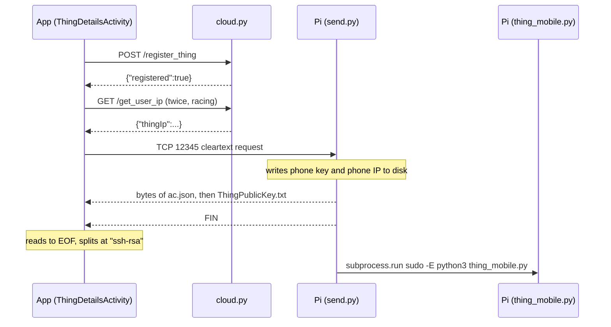
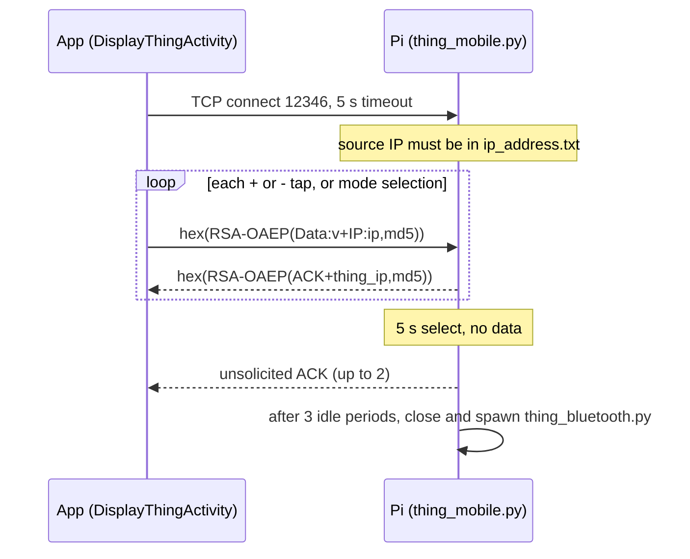
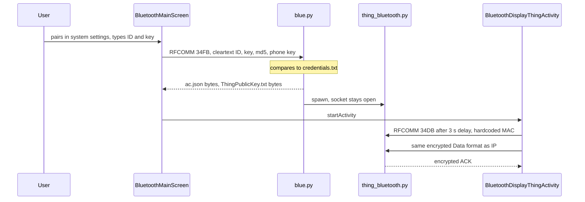

Status: RESEARCH, not a design ruling. Sources read: `send.py`, `thing_mobile.py`, `blue.py`, `thing_bluetooth.py`, `thing_mobile_bluetooth.py`, `adhocServer.py`, `air_conditioner.py`, `cloud.py` (connection values masked), `ipverify.py` (connection values masked), `K/ThingDetailsActivity.kt`, `K/DisplayThingActivity.kt`, `K/BluetoothMainScreen.kt`, `K/BluetoothDisplayThingActivity.kt`, `K/Adhoc.kt`, `K/ApiService.kt`, `K/CheckActivity.kt`, `app/src/main/python/*.py`, paper Figs 3 to 8, RFC 8017 (EXTERNAL). Nothing was run: timings are from code constants.

# 05: Device protocol and data output

Paths are relative to `/media/sandesh/extra-ssd/AndroidWork/OneIOTApp`. `K/` means `app/src/main/java/com/example/iot1/`. All payload examples use placeholders.

## 1. F1: discovery and pairing

| Mode | How the phone finds the device | Identity | Evidence | Tag |
|---|---|---|---|---|
| IP | HTTP lookup of Thing ID at the cloud, one time | User-typed Thing ID and Thing Key | `K/ThingDetailsActivity.kt:333-355` | VERIFIED |
| Bluetooth | Waits for a system ACL-connected broadcast, so the user pairs and connects outside the app first | Same fields, sent to the device | `K/BluetoothMainScreen.kt:53-66` | VERIFIED |
| Bluetooth, control phase | Hardcoded MAC `B8:27:EB:D3:65:ED`; the intent extra is commented out | none | `K/BluetoothDisplayThingActivity.kt:86-89` | VERIFIED |
| Adhoc | Hardcoded `192.168.4.1` | none | `K/Adhoc.kt:340` | VERIFIED |
| mDNS, NSD, BLE scan, QR | Absent | n/a | whole app | VERIFIED |

## 2. Cloud HTTP API

Base `http://10.203.6.97:5000/`, cleartext (`K/ApiService.kt:37`, `app/src/main/res/xml/network_security_config.xml:3-4`).

| Call | Request JSON | Success | Errors | Handler |
|---|---|---|---|---|
| `POST /validate_user` | `{"username","userpassword"}` | `{"valid":bool}` | Route missing, so 404 in this `cloud.py` | `K/ApiService.kt:24-25` |
| `POST /register_user` | `{"username","email","mobileNum","thingId","mobileIp"}` | `{"registered":bool}` | 400 unknown Thing, 500 with exception text | `cloud.py:72-118` |
| `POST /register_thing` | `{"thingName","thingId","thingKey"}` | `{"registered":bool}` | 400, 500 | `cloud.py:120-171` |
| `GET /get_user_ip?thingId=` | none | `{"thingIp":"..."}` | 400, 404, 500 | `cloud.py:173-210` |

The app's parse of errors is coarse: `get_user_ip` failures become the literal string `default_ip`, which is stored as the Thing's address (`K/ThingDetailsActivity.kt:343-351,176`).

## 3. F2: manifest delivery over IP



Request (`K/ThingDetailsActivity.kt:209-214`):

```
'send_file',<phone_ip>:<md5("'send_file',<phone_ip>")>@ssh-rsa <base64 phone public key>
```

Parsed on the Pi by `split('@')`, then `split(':')`, then `split(',')` (`send.py:38-56`).

Response: raw concatenation, no framing, no length, no type (`send.py:72-80`):

```
<ac.json bytes>ssh-rsa <base64 thing public key>
```

| Property | Value | Evidence |
|---|---|---|
| Who starts | Phone pulls, after registration | `K/ThingDetailsActivity.kt:138` |
| Port | 12345 | `K/ThingDetailsActivity.kt:48`, `send.py:16` |
| Framing | EOF | `K/ThingDetailsActivity.kt:229` |
| Connect timeout | Android default, none set | `K/ThingDetailsActivity.kt:205` |
| One shot | Script handles one connection then replaces itself with `thing_mobile.py` | `send.py:24,89-90` |
| Storage | `getExternalFilesDir("")/manifest.json`, `thingPublicKey.txt` | `K/ThingDetailsActivity.kt:219,222,244` |
| Timing bug | Save and fetch race, and the activity navigates and finishes while fetching | `K/ThingDetailsActivity.kt:136-143` |
| Per-model or per-unit | Same file for all units in practice | `send.py:72` |

## 4. F6: command channel over IP



### Message formats

Plaintext sent (`K/DisplayThingActivity.kt:497-499`):

```
Data:<value>+IP:<phone_ip>,<md5("Data:<value>+IP:<phone_ip>")>
```

Example shape: `Data:16.5+IP:10.0.0.5,<32 hex>`.

Wire form: UTF-8 of lowercase hex of the RSA-2048 ciphertext, so 512 ASCII characters and no delimiter (`app/src/main/python/encrypt.py:25`). Length limit on plaintext: `k - 2*hLen - 2` = 256 - 64 - 2 = **190 bytes** for RSA-2048 with SHA-256 (EXTERNAL: [RFC 8017 section 7.1.1](https://www.rfc-editor.org/rfc/rfc8017)). The value is limited to about 130 bytes after the IP and checksum (INFERRED).

Reserved characters: `,`, `+`, `:` in a value or a mode name break Pi parsing (`thing_mobile.py:61,64,67`). IPv6 in the `IP:` field would break the `:` split (INFERRED).

Reply (`thing_mobile.py:94-104`):

```
ACK+<thing_ip>,<md5("ACK+<thing_ip>")>
```

Encrypted to `MobilePublicKey.txt`, hex encoded. App check: decrypt, split, compare MD5 (`K/DisplayThingActivity.kt:561-592`). It does not compare the IP with the expected device, and the ACK has no message id, so it cannot be matched to a command.

### Timing and retry

| Constant | Value | Evidence |
|---|---|---|
| Connect timeout | 5000 ms | `K/DisplayThingActivity.kt:384` |
| Read timeout | 5000 ms | `:495,510` |
| Wi-Fi attempts per command | 3, with 1000 ms sleep | `:494,534` |
| Each retry resends the same command | Yes, no id or dedupe | `:508-512` |
| Device idle wait | 5 s per select, 3 strikes | `thing_mobile.py:47,109` |
| Worst-case time to give up over Wi-Fi | About 18 s | INFERRED: 3 x (5 s + 1 s) |

### Keepalive and lifecycle

- **No heartbeat between phone and device.** None by design. The idle ACKs are a side effect (`thing_mobile.py:107-129`).
- **Phone side:** one socket opened in `onCreate` and never reopened. Once closed, later sends go to Bluetooth streams (`K/DisplayThingActivity.kt:91,378-393,541`). There is no `onDestroy` close: the code is commented out (`:725-735`).
- **Device side:** 15 s idle is fatal for the IP channel. It closes and starts Bluetooth, and nothing returns to IP (`thing_mobile.py:130-135`). Every normal session therefore ends in Bluetooth mode.
- **Stale ACKs:** unsolicited ACKs stay queued until the next read. The next command can read an old ACK as its reply. Two queued ACKs arrive as 1024 hex characters, which fail to decrypt and count as a failure, causing a resend (INFERRED, `K/DisplayThingActivity.kt:515-520`).

## 5. Heartbeat to the cloud

`ipverify.py:50-59`: every 5 s, find the WLAN IP via a UDP socket to `8.8.8.8`, then `UPDATE vendor SET thingIp = ? WHERE thingId = ?` with a hardcoded Thing ID, direct over ODBC. `cloud.py:40-70` copies `vendor` to `user` every 5 s. The protocol has no heartbeat message.

## 6. Bluetooth (R0-6c)

| Item | Value | Evidence | Tag |
|---|---|---|---|
| Technology | Bluetooth Classic RFCOMM | `blue.py:18`, `thing_bluetooth.py:24` | VERIFIED |
| BLE GATT | None | whole folder | VERIFIED |
| Pi library | PyBluez (`import bluetooth`), run under sudo in a Python 3.9 venv | `thing_bluetooth.py:1`, `blue.py:82` | VERIFIED |
| Android API | `createRfcommSocketToServiceRecord` | `K/BluetoothMainScreen.kt:106`, `K/BluetoothDisplayThingActivity.kt:140` | VERIFIED |
| Handshake service | UUID `00001101-0000-1000-8000-00805F9B34FB` (standard SPP), name `SampleServer` | `blue.py:15,24`, `K/BluetoothMainScreen.kt:50` | VERIFIED |
| Command service | UUID `00001101-0000-1000-8000-00805F9B34DB`, name `TemperatureService`, also claims the SPP class | `thing_bluetooth.py:22,35,37`, `K/BluetoothDisplayThingActivity.kt:60`, `K/DisplayThingActivity.kt:57` | VERIFIED |
| Channel | `PORT_ANY`, found by SDP. Older script: fixed channel 1 | `thing_bluetooth.py:27`, `thing_mobile_bluetooth.py:16` | VERIFIED |
| Discoverable | `bluetoothctl discoverable on`, piped | `thing_bluetooth.py:8-9` | VERIFIED |
| Allowlist | Peer MAC must be in `bluetooth_address.txt`; no script here writes it | `thing_bluetooth.py:44-49,58` | VERIFIED |

### Bluetooth handshake and manifest



Request (`K/BluetoothMainScreen.kt:126-133`):

```
thingId: <id> thingKey: <key> + <md5("thingId: <id> thingKey: <key>")>%ssh-rsa <base64 phone public key>
```

Parsed by `split('%')`, then `split('+')`, then `split('thingId: ')` (`blue.py:94-100,53-55`). A `+` or `%` in a key breaks it.

Framing on RFCOMM: same as TCP, a single `recv(1024)` with no length prefix (`thing_bluetooth.py:65`). The app reads to `-1` into `random.json` on a background coroutine, while the main thread immediately calls `SplitFiles` (`K/BluetoothMainScreen.kt:134-135,151-153`). That is a race; the 3 s delay in the next screen partly hides it (`K/BluetoothDisplayThingActivity.kt:82,102`).

### Format mismatch on Wi-Fi to Bluetooth fallback

`DisplayThingActivity.sendViaBluetooth` sends the older form `"<data>,<ip>":<md5>` (`K/DisplayThingActivity.kt:602`). `thing_bluetooth.py` expects the `Data:...+IP:...,md5` form and indexes `[1]` after `split(':')` (`thing_bluetooth.py:80-85`). An `IndexError` is not caught there (`:124`), so the fallback path would kill the Pi script (INFERRED). `BluetoothDisplayThingActivity` uses the matching form (`K/BluetoothDisplayThingActivity.kt:442-444`).

## 7. Adhoc (R0-6d)

- **Client:** `K/Adhoc.kt:338-395` sends `"<data>,<ip>":<md5>` encrypted, by calling a Python module named `client` (`:363`). The app's Python folder has no `client.py`; it has `adhoc.py`, whose `send_message` takes one argument where three are passed (`app/src/main/python/adhoc.py:3`, `K/Adhoc.kt:366`).
- **Server:** `adhocServer.py` echoes plain text on 12345 and decrypts nothing (`adhocServer.py:21-27`).
- **Reach:** only when the user refuses to enable Bluetooth while offline (`K/CheckActivity.kt:87-93`). It reads a file nothing writes (`K/Adhoc.kt:49`), and never starts Python, which it relies on (`K/Adhoc.kt:362`; no `Python.start` in `K/CheckActivity.kt`).
- **Status:** demo stub that cannot run as written (INFERRED). No hotspot or Wi-Fi Direct API is used.

## 8. F5: data production on the Pi

Nothing to document at byte level, because no reading is produced.

| Question | Answer | Evidence |
|---|---|---|
| Simulated readings | None on the Pi scripts | `thing_mobile.py`, `thing_bluetooth.py` |
| Real sensor stubs | None | imports listed in `01` section 3 |
| Output format, framing, units | None exists | same |
| Timestamps, clock source | None. No script uses time except a heartbeat sleep | `ipverify.py:58`, `cloud.py:70` |
| Device identity in payload | Only a `thing_ip` in the ACK, from a file | `thing_mobile.py:87-95` |
| Error signalling | ACK or silence. Nothing says "failed" | `thing_mobile.py:105-106` |
| Completion signalling | None | same |
| Effect of a command | `print` only. `air_conditioner.py` swaps an image in a simulated window | `thing_mobile.py:84`, `air_conditioner.py:54-57` |

## 9. Paper protocol vs what runs

The nearest code to the paper's protocol is the laptop simulation `air_conditioner.py`, which matches on substring: `Probe` returns `<name>:file:<content>`, and `Invoke` parses a temperature (`air_conditioner.py:20-33`). The Android app does not speak this form. Its old predecessor did (`Untitled Document 1:174`). The two sides of the current system share only ad hoc string formats, with no version field.

## 10. Summary for integration

| Concern | State |
|---|---|
| Transport to adopt | None of these. All are cleartext or use the ruled-out crypto |
| Payload format to adopt | None exists for readings |
| Timing data worth keeping | RSA limits and retry numbers are cautionary only |
| Concept worth keeping | Pull a manifest from the device, then draw controls from it |

Measured in scope changes S1 and T-0 (2026-11-06): the demo keeps the OneIoT app, and RFCOMM is to be replaced by Wi-Fi, BLE, wired and NFC bearers under one envelope. Section 10 stands as an assessment of today's formats. Bearer options are in `11b` (Phase 3).

Terminology per A7: section 4's "No heartbeat between phone and device" means app-to-hub **liveness**. **Heartbeat** is only the device-to-cloud IP reporting in section 5. That reporting has a rate fixed at 5 s (`ipverify.py:58`), where the paper describes a configurable tick rate.

## 11. Addendum A1: documented message structures (DOCS-ONLY)

Pages rendered at 150 dpi to `/media/sandesh/extra-ssd/oneiot-study/figs/`: `paper-08.png`, `paper-10.png`, `paper-12.png`, `paper-18.png`, `tih-16.png`, `tih-17.png`. All tables here are DOCS-ONLY. None of these structures appears on the wire in code, except where stated.

### Paper Fig 3: message structure (p.8)

| Part | Field |
|---|---|
| Header | Protocol Name and Ver |
| Header | Encryption Type |
| Body | Payload |

### Paper Fig 4: request payload (p.8)

| Field | Note from the paper's text |
|---|---|
| Protocol Name | For example `PROBE` |
| Operation name | Empty in PROBE |
| Arguments | Empty in PROBE |

### Paper Fig 5: response payload (p.8)

| Field |
|---|
| Outputs |

### Paper Fig 6: concept (p.8)

| Step | From, to | What |
|---|---|---|
| 1 | Device node, cloud node | Device connects to cloud |
| 2 | Client node, cloud node | Client gets device address |
| 3 | Device node, client node | Manifest file |
| 4 | Client node, device node | Operation name, arguments |
| 5 | Device node, client node | Output |

### Paper Fig 7: registration, probe, invoke (p.10)

| # | Direction | Message |
|---|---|---|
| 1 | Client to cloud | `userid, tid, tkey` |
| 2 | Cloud internal | `validate(user)` |
| 3 | Cloud internal | `checkThingKey(tid, tkey)` |
| 4 | Cloud internal | `grantAccess(user, thing)` |
| 5 | Cloud to client | `true` |
| 6 | Client to cloud | `REQ.-ADD., tid, tkey` |
| 7 | Cloud to client | `ip address:port number` |
| 8 | Client to device | `PROBE` |
| 9 | Device to client | JSON Parse-able Format |
| 10 | Client to device | `Invoke, Operation name, Arguments` |
| 11 | Device to client | `Outputs` |

### Paper Fig 8: invoke operations (p.12)

| Operation | Target |
|---|---|
| GET | Sensor's name |
| GET | Actuator's name |
| SET | Actuator's name |

### Paper Fig 12: MMF example (p.18)

Same content as `ac.json` over 31 lines, with `ACTUATOR` at line 15 where `ac.json:15` says `CONTROL`.

### TIH Fig 9: data packet structure (p.16)

| Layer | Contents |
|---|---|
| Data | Message, IP Address |
| Inside encryption | Data, CheckSum |
| Outer | Encryption, forming the Data Packet |

This one **does** match code: `Data:<message>+IP:<ip>,<md5>` inside RSA (section 4).

### TIH Fig 10: app flow chart (p.17)

| From | Condition | To |
|---|---|---|
| `onStart()` | none | `LoginActivity()` |
| `LoginActivity()` | existing user: no | `RegisterActivity()`. On success, save userName, userEmail, userMobile, thingId, thingName to the OEM server and userName, password locally, then back to login |
| `LoginActivity()` | existing user: yes, credentials fail | Toast: Invalid Credentials |
| `LoginActivity()` | credentials succeed | `AvailableThingsActivity()` |
| `AvailableThingsActivity()` | Thing true | Initiate Communication |
| `AvailableThingsActivity()` | Thing false | Add device: select vendor, enter thingId, ThingKey, ThingName, Submit. On success, set Thing true and return |

The chart has no Bluetooth or offline branch, while `K/CheckActivity.kt:28-32,87-93` has both. It names `LoginActivity`; the class is `MainActivity`.

### TIH 8.4 envelope (text, no figure)

| Field | Stated content |
|---|---|
| `protocol` | "OpenOneIoT" |
| `version` | not given |
| `phase` | DISCOVERY, REGISTER, PROBE, INVOKE, CONFIGURE |
| `token` | Bearer token |
| `timestamp` | not given |
| `payload` | not given |

## 12. Addendum T-1: bearer inventory (VERIFIED by search over the file list)

### Bluetooth Classic RFCOMM

| File:line | Role | Side | UUID or channel | Library | Framing | Status |
|---|---|---|---|---|---|---|
| `blue.py:18-20,23-28` | Server | Pi | `...34FB`, `PORT_ANY`, name `SampleServer`, backlog 10 | PyBluez | One `recv(1024)`; split on `%`, `+`. File sent with `sendall`, end unmarked, socket stays open | Live |
| `thing_bluetooth.py:24-39` | Server | Pi | `...34DB`, `PORT_ANY`, name `TemperatureService`, backlog 1 | PyBluez | One `recv(1024)` of hex. Also runs `bluetoothctl discoverable on` (`:8-9`) | Live |
| `thing_mobile_bluetooth.py:15-18` | Server | Pi | Fixed channel 1, no SDP | PyBluez | One `recv(1024)` of hex | Dead |
| `K/BluetoothMainScreen.kt:50,106-109` | Client | App | `...34FB` | `createRfcommSocketToServiceRecord` | Write once; read to `-1` with an 8 KB buffer | Live |
| `K/BluetoothDisplayThingActivity.kt:60,140-150` | Client | App | `...34DB`, hardcoded MAC at `:89` | Same | Write once; one read with a 1 KB buffer | Live |
| `K/DisplayThingActivity.kt:57,677-686` | Client | App | `...34DB`, hardcoded MAC at `:59` | Same | Same, older message form (`:602`) | Fallback, broken |

The Pi is always the server and the phone always the client. There is no `listenUsingRfcomm` in the app (0 hits), although TIH 7.1 describes the phone-side server API. All full UUIDs start `00001101-0000-1000-8000-00805F9B`.

Replaced under T-0: all of the above. Android BLE, NFC and USB code: 0 hits in this folder.

### IP sockets

| File:line | Role | Port | Framing, message boundary | Status |
|---|---|---|---|---|
| `send.py:19-24,35,74,79` | TCP server, one accept | 12345 | Request: one `recv(1024)`, assumes whole message. Reply: `sendall`, end marked by close | Live |
| `K/ThingDetailsActivity.kt:205,214,229` | TCP client | 12345 | Write once, read to EOF | Live |
| `thing_mobile.py:16,29-31,48,104,129` | TCP server, backlog 5, non-blocking client | 12346 | One `recv(1024)` of hex, assumes exactly one message. No delimiter or length | Live |
| `K/DisplayThingActivity.kt:379,383-386,511,516` | TCP client, persistent | 12346 | Write hex, one read with a 1 KB buffer. Two queued replies merge | Live |
| `K/Adhoc.kt:340-341,366`, `app/src/main/python/adhoc.py:4-5,9-16` | TCP client | 12345 at `192.168.4.1` | One send, one `recv(1024)` | Broken |
| `adhocServer.py:4-10,21,27` | TCP server | 12345 | One `recv(1024)` per connection, plain text | Demo |
| `K/ApiService.kt:37` to `cloud.py:218` | HTTP | 5000 | HTTP, Retrofit and Flask | Live |
| `cloud.py:24-31`, `ipverify.py:24-34` | ODBC client to SQL Server | default | Driver | Live |
| `ipverify.py:12-14` | UDP socket, connect only, no data, to learn local IP | 8.8.8.8:80 | n/a | Live |
| `air_conditioner.py:48` | Twisted TCP server | 8004 | `dataReceived` substring match | Simulation |
| `Untitled Document 1:162-176` | TCP client, new socket per value | 8004 | Write plain string, close | Dead |
| `decrypter.py:29-39`, `encrypter.py:27-31,49` | TCP server and client | 65432 | `<hex>::<md5>`, one `recv(4096)` | Experiment |

Common weakness (INFERRED): TCP is a byte stream. Every message reader here assumes one `recv` returns one message, which T-3's length-prefixed framing is meant to fix.
