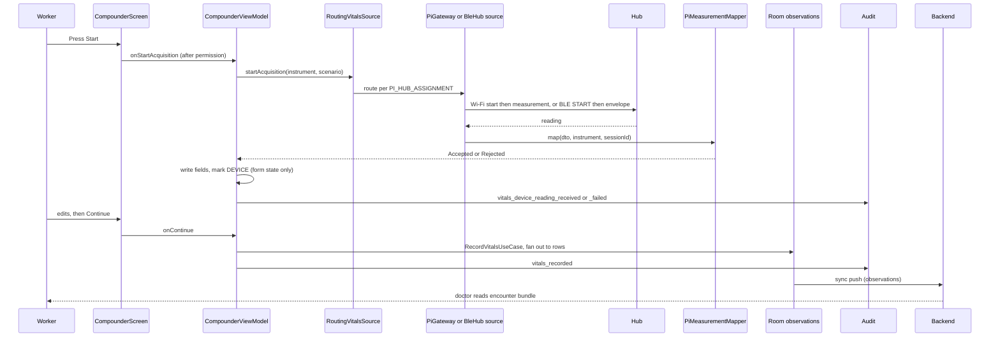

Status: RESEARCH, not a design ruling. Sources read: study worktree `/media/sandesh/extra-ssd/wt-oneiot-study` at `4b9ee3c` (never the main checkout): `VitalsSource.kt`, `VitalsUseCases.kt`, `CompounderViewModel.kt` (lines 120-239, 470-730), `CompounderProvenance.kt`, `CheckEmergencyThresholdsUseCase.kt`, `NumericInputFilters.kt`, `VitalsSnapshot.kt`, `Observation.kt`, `app/src/dev/.../vitalssource/**` (`BleHubManager`, `BlePrepActivity`, `NsdGatewayDns`, `HubLocalNetworkNeed` by targeted lines), `docs/design/samdpi-two-hub-memo.md` sections 10, 14.5, 14.6, `PROGRESS.md` two-hub entries, `backend/core/app/models/clinical.py`. Nothing was run.

Tag key: a claim with a file:line citation and no other tag is VERIFIED, read in code at the commit named above. A citation to another memo inherits that memo's tag. Anything else is marked INFERRED, DOCS-ONLY or EXTERNAL.

# 08: SaMD-App's current vitals pipeline

Paths: `A/` is `app/src/main/java/com/example/samdapp/`, `D/` is `app/src/dev/java/com/example/samdapp/data/vitalssource/`.

**Note on `docs/adr/`:** the project `CLAUDE.md` in the main checkout cites `docs/adr/`, but no such folder exists at `origin/master` `4b9ee3c`. That `CLAUDE.md` is itself dirty in the main checkout. So no ADR could be checked here. OQ for `14`.

## 1. One reading, end to end

## 2. Classes, in order

| Step | Class | Evidence |
|---|---|---|
| Dev-only UI gate | `BuildConfig.PI_GATEWAY_ENABLED` | `A/presentation/compounder/CompounderScreen.kt:195`, `app/build.gradle.kts:141,198,206` |
| Permission, then Start | `rememberLocalNetworkPermissionAction` in `AcquisitionControls` | `CompounderScreen.kt:291-295` |
| Need for local-network request | `HubLocalNetworkNeed` | `A/domain/vitalssource/HubLocalNetworkNeed.kt:9`, `CompounderViewModel.kt:575-576` |
| Start | `onStartAcquisition` with in-flight guard | `CompounderViewModel.kt:520-573` |
| Use case | `AcquireDeviceVitalsUseCase` | `A/domain/usecase/VitalsUseCases.kt:31-36` |
| Route | `RoutingVitalsSource`, no fallback between wires | `D/RoutingVitalsSource.kt:46-56` |
| Assignment | `HubAssignment`; default `SPO2=wifi:kernelhub1,BP=ble:kernelhub2` | `D/HubAssignment.kt:56`, `app/build.gradle.kts:56` |
| Wi-Fi | `PiGatewayVitalsSource`, `PiGatewayApi` | `D/PiGatewayVitalsSource.kt:54-101`, `D/PiGatewayApi.kt:22-33` |
| Hub identity | `HubIdInterceptor`, `X-SaMDPi-Hub-Id` on every response | `D/HubIdInterceptor.kt:25-33` |
| mDNS | `NsdGatewayDns`, service `_samd-gw._tcp`, on the gateway client only | `D/NsdGatewayDns.kt:83`, `app/build.gradle.kts:151-153` |
| F1 gate | `LocalNetworkGate.blocksHost`, `LocalNetworkGateInterceptor` | `A/domain/connectivity/LocalNetworkGate.kt:20`, `A/data/remote/LocalNetworkGateInterceptor.kt:19` |
| BLE preparation | `BleHubVitalsSource`, API 33 or later | `D/ble/BleHubVitalsSource.kt:55-98,108` |
| CDM association | `BlePrepActivity`, `HubAssociations` | `D/ble/BlePrepActivity.kt:107-124`, `D/ble/HubAssociations.kt:41-44` |
| BLE exchange | `BleAcquisition`, 25 s cap | `D/ble/BleAcquisition.kt:34,121-198` |
| Gates | `PiMeasurementMapper`: RC-2, RC-1 session, RC-1 device type, then map | `D/PiMeasurementMapper.kt:39-53` |
| Result | `AcquisitionResult.Accepted`, `Rejected` | `A/domain/vitalssource/VitalsSource.kt:86-113` |
| Form write | `applyAcceptedReading`, only non-null fields | `CompounderViewModel.kt:620-656` |
| Field marks | `VitalsFieldProvenance`, not persisted | `A/presentation/compounder/CompounderProvenance.kt:24` |
| Save | `onContinue`, then `RecordVitalsUseCase` | `CompounderViewModel.kt:658-716` |
| Fan out | `VitalsRepositoryImpl`, one row per vital | `A/data/repository/VitalsRepositoryImpl.kt:51-61,66-74` |
| Entity | `ObservationEntity`, table `observations` | `A/data/local/entity/ObservationEntity.kt:12-23` |
| Sync | `toSyncRecord`, outbox | `A/data/sync/SyncRecordMappers.kt:95-104`, `RoomSyncOutboxRepository.kt:119,160` |
| Server row | `Observation`, enum checks, no value checks | `backend/core/app/models/clinical.py:36-69` |
| Doctor | Encounter bundle includes observations | `backend/core/app/api/v1/encounters.py:252` |

Sync count: the brief says 19 synced tables. `LocalClinicalData.kt` has 23 `EntityScope` entries, and `observations` is one (`:53`). The 19 figure was not confirmed; scope lists may differ from sync lists.

## 3. Audit

| Action | When | Payload | Evidence |
|---|---|---|---|
| `vitals_device_reading_received` | On Accepted | sessionId, deviceType, instrument, synthetic, hubId, transport, emulatorBuild, measuredAt, fieldsPopulated, fieldProvenance. Never a value | `CompounderViewModel.kt:531-549`, `A/domain/audit/AuditLogger.kt:60-63` |
| `vitals_device_reading_failed` | On Rejected | sessionId (see D4), instrumentRequested, rejectReason, hubId, transport | `CompounderViewModel.kt:558-569`, `AuditLogger.kt:65-70` |
| `vitals_recorded` | On save | pulse, systolic | `CompounderViewModel.kt:686-691` |

Backend accept-set: `backend/core/app/domain/audit_actions_device.py:106-108`.

## 4. RC-1 to RC-4

| Control | Meaning | Where |
|---|---|---|
| RC-1 | Session id and device type must match this acquisition | `PiMeasurementMapper.kt:44-53` |
| RC-2 | Quality exactly "OK" | `PiMeasurementMapper.kt:39-41` |
| RC-3 | Worker can edit any value | `CompounderViewModel.kt:728`, form stays editable (`:178-181`) |
| RC-4 | Only `onContinue` writes the record | `CompounderViewModel.kt:515-519` |

The Pi stays an accessory outside the device boundary only while all four hold (`docs/design/samdpi-two-hub-memo.md:1106-1107`, PROPOSED). Hazard rows H-37 to H-45 are PROPOSED there (`:1819-1829`), not in the risk file.

## 5. Vitals form (R1-5b)

| Field | Label and unit | Input rule | Stored unit | Plausibility bound | Evidence |
|---|---|---|---|---|---|
| Pulse | "Pulse (bpm)" | digits, max 3 | `bpm` | **None** | `CompounderScreen.kt:218`, `Observation.kt:6` |
| BP systolic | "BP systolic", no unit in label | digits, max 3 | `mmHg` | **None**, emergency only | `:222`, `Observation.kt:7` |
| BP diastolic | "BP diastolic", no unit in label | digits, max 3 | `mmHg` | **None**, emergency only | `:223`, `:8` |
| SpO2 | "SpO2 (%)" | digits, max 3 | `%` | **None**, emergency only | `:227`, `:9` |
| Temperature | "Temperature (°C)" | decimal | `°C` | **None** | `:230`, `:10` |
| Respiratory rate | "Respiratory rate (breaths/min)" | digits | `breaths/min` | **None** | `:233`, `:11` |
| Weight | "Weight (kg)" | decimal | `kg` | **None** | `:237`, `:12` |
| Height | "Height (cm)" | decimal | `cm` | **None** | `:238`, `:13` |
| BMI | Derived | n/a | `kg/m²` | Guards height 0 only | `CompounderViewModel.kt:147-154` |
| Pain score | "Pain score (0-10)" | digits, max 2 | none | **None**: label says 0-10, nothing enforces it | `:243` |
| Blood glucose | "Blood glucose (mg/dL)" | digits, max 3 | `mg/dL` | **None** | `:260`, `:15` |
| Urinalysis | "Urinalysis result" | free text | none | n/a | `:263` |

Input filters: `A/presentation/common/NumericInputFilters.kt:5-22`, cited by risk row H-01 (`docs/quality/risk-management-file.md:24`). They restrict characters and length, not values.

Emergency thresholds, the only numeric rules at save: SpO2 under 90, systolic 180 or more or under 90, diastolic 120 or more (`A/domain/usecase/CheckEmergencyThresholdsUseCase.kt:20-23,28-35`). The file calls them "a starting point for clinical review" (`:15-16`).

### Who owns clinical bounds today

- **App code owns the emergency thresholds**, as hardcoded constants, for 3 fields only.
- **Nobody owns plausibility.** A value such as 999 mmHg saves (`CompounderViewModel.kt:668-671` only parses). The backend has enum checks and no value checks on `observations` (`clinical.py:40-47`). Search of `backend/core/app` found no vital bounds, and the clinical kernel was not read.
- Device readings get no bounds either: the mapper gates quality, session and type only (`PiMeasurementMapper.kt:39-53`).

R1-6's rule ("clinical bounds owned by SaMD") therefore names an owner, but there is no plausibility table for it to own yet. This matters for Phase 3 (OQ).

## 6. Provenance gaps

| Gap | Evidence | Consequence |
|---|---|---|
| Field-level marks not persisted | `CompounderProvenance.kt:15-18` | Only a per-snapshot `source` reaches the record |
| `deviceId` not set on save | `VitalsSnapshot(...)` at `CompounderViewModel.kt:665-682` passes none | A device reading's `observations.device_id` stays null, so the audit row is the only device link |
| Unit not checked | `PiMeasurementMapper.kt` never reads `dto.unit` | A wrong unit from a hub or manifest passes |
| Rounding | BP, SpO2, pulse rounded half up, temperature passes through (`PiMeasurementMapper.kt:56-70,104`) | Known and deliberate |
| Synthetic not persisted | `docs/design/samdpi-two-hub-memo.md:1083` | Residual, filed |
| Capture method is the worker's attestation; autofill never writes it | `CompounderScreen.kt:285-287` | A new "OneIoT" value is a synced enum: backend `enum_check` must learn it (`clinical.py:44`) |

## 7. Known open defects, as they appear in code

| Defect | Where | Effect |
|---|---|---|
| **D4 stale sessionId** | `CompounderViewModel.kt:525,563`: `current` is captured before Start, so a failed row logs the previous session's id. The brief's "near 557, 578, 627" are now 563, 578-580, 636 | Audit row names the wrong session. PROGRESS F4 HIGH (`PROGRESS.md:5571`) |
| **F2 HUB_MISMATCH vs UNREACHABLE** | `D/ble/BleAcquisition.kt:205-208`: missing instrument service maps to UNREACHABLE | "Move closer" is false for a misrouted hub (`PROGRESS.md:5566-5568`) |
| **Wizard Back dead end** | Dead-end spinner `A/presentation/sending/SendingScreen.kt:62`, reached by back (`PROGRESS.md:5353`, F5 at `:5572`). Not traced further here | Worker stuck |
| **Composite G-A** | SaMDPi `generator/multi_worker.py:260-275` substitutes defaults (120, 80, 72, 98, 36.8...) when a reading is absent, and quality is forced to OK (`:288`) | Fabricated vitals. Unreachable on hubs: 404 (`server.py:240,305`), module not shipped (`DEPLOY.md:31-33`). Must not be reused |

## 8. Android BLE side (T-2)

| Item | Value | Evidence |
|---|---|---|
| Library | Nordic `no.nordicsemi.android:ble-ktx` 2.11.0, `BleManager` subclass | `gradle/libs.versions.toml:28,36`, `D/ble/BleHubManager.kt:19,27` |
| Dependency scope | `devImplementation` only; staging and prod carry none | `docs/design/samdpi-two-hub-memo.md:1804-1806` |
| Discovery | CDM `AssociationRequest` with vendor service UUID and name `^SaMD-<hub_id>$`, single device | `D/ble/BlePrepActivity.kt:113-117` |
| Identity | Association id stored, never name; DIS Serial plus envelope `hub_id` | `D/ble/HubAssociations.kt:41-44`, `D/ble/BleAcquisition.kt:144-149,183` |
| Init | MTU 517 requested, CCCDs enabled, before any Control Point write | `D/ble/HubInitPlan.kt:26-29` |
| Permissions | `BLUETOOTH_CONNECT`, dev manifest only; no scan permission | `app/src/dev/AndroidManifest.xml:21-23` |
| Guard | Main sources contain no Bluetooth surface | `app/src/test/java/com/example/samdapp/config/MainHasNoBluetoothSurfaceTest.kt:8,26` |
| USB, NFC in app | 0 hits in `app/src` | search |
| NFC design note | One line only: a device over Bluetooth, Wi-Fi or NFC | `docs/design/dataset-regeneration-design-memo.md:396` |
