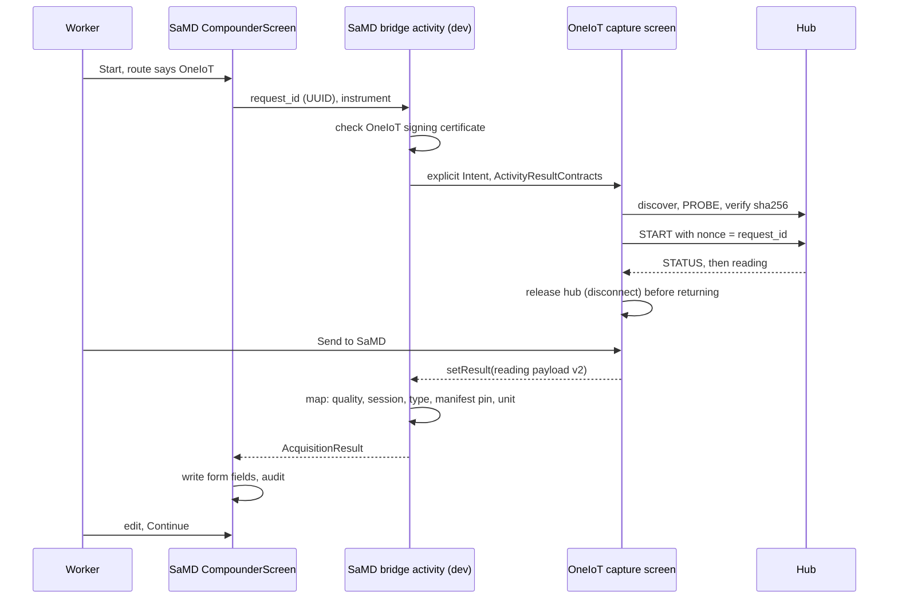

Status: RESEARCH, not a design ruling. Recommendations are labelled and pend the operator's ruling at STOP 3. Sources read: memos `02` to `09`, `12`; SaMD-App at `4b9ee3c`; SaMDPi at `bba2c6b`; `docs/design/samdpi-two-hub-memo.md` sections 10, 14.5; `docs/design/local-network-permission-memo.md` (hub parts); Android docs linked below. Efforts are INFERRED estimates, about plus or minus 50 percent.

Tag key: a claim with a file:line citation and no other tag is VERIFIED, read in code at the commit named above. A citation to another memo inherits that memo's tag. Anything else is marked INFERRED, DOCS-ONLY or EXTERNAL.

# 10: Integration options

`A/` is `app/src/main/java/com/example/samdapp/`. `D/` is `app/src/dev/java/com/example/samdapp/data/vitalssource/`. `E/` is SaMDPi `emulator/`. `K/` is OneIoT `app/src/main/java/com/example/iot1/`.

## 0. Summary of recommendations (pending ruling)

| Question | Recommendation | Section |
|---|---|---|
| Demo bridge | **D1**, same phone, SaMD launches OneIoT | 1, 2 |
| How to change OneIoT | **P2**, with a shortened stage order | 1.7, 2 |
| Cloud | **R4 as end state, R3 as a stepping stone** | 3 |
| Demo crypto | **Drop RSA, MD5, Chaquopy.** Identity and correlation controls, plus manifest pin | 3 |
| targetSdk 37 from Stage 1 | **Yes, in the new shell**; do not repair old screens for it | 3 |
| Bluetooth | **BLE GATT only, reuse the SaMDPi stack** | 3 |
| Hub side | **A1**, in-process | 4 |
| Target after the demo | **T1**, subject to a boundary and release ruling | 6 |
| Gate on the bridge | **No bridge ships before unit checking and canonicalisation** | 1.4, `13` |

## Part 1: Demo bridge

### 1.1 Options

| Criterion | D1 Same phone, SaMD launches, result returned | D2 Same phone, OneIoT pushes | D3 Separate device, WebSocket | Quick Share |
|---|---|---|---|---|
| Who starts | Worker in SaMD, with patient open | OneIoT, any time | Either | Worker, in share sheet |
| Fits "no autonomous ingestion" (boundary rationale 3, `docs/design/samdpi-two-hub-memo.md:1096-1097`) | **Yes** | **No**: data arrives nobody asked for | Only if SaMD opens it per session | Yes, but manual |
| Exported surface in SaMD | **None new.** SaMD only launches | New exported service or receiver | New listening socket | Share target or file handling |
| Patient and session binding | Bound at launch, in the open screen | Must guess which patient is open | Needs a pairing step | **None**: a file with no context |
| RC-1 | **End to end**: request id is the hub nonce (`12` section 4.6) | Weak | Possible with ack | None |
| RC-2, RC-3, RC-4 | Unchanged: same mapper, same form | RC-4 at risk | Unchanged if form-only | Lost |
| F1 local-network gate | **Not touched in SaMD**: OneIoT owns LAN | Same | Applies to SaMD | n/a |
| Bluetooth in SaMD release | None added (guard G-B11b holds) | None | None | None |
| New SOUP in SaMD | None | None | Server library, or hand-written socket | None |
| Duplicate send | One result per launch | Needs dedupe | Needs ack and idempotency | Repeated file |
| What changes in SaMD | Section 1.3 | Exported service or receiver, signature permission, caller check, rule for a push with no screen open | Socket client or server, F1 gate, pairing UI, ack, idempotency store | Share target, file parser |
| Spoofing | Fake OneIoT refused by the certificate check; no inbound path into SaMD | Any caller of the exported entry, unless signature permission and caller UID check hold | Any LAN host, unless paired; the link has no authentication | Any app or person can share a file |
| Process death of either app | SaMD killed: result dropped, retake. OneIoT killed: `RESULT_CANCELED` | SaMD killed: nothing to receive; a restart has no open screen | Socket closes, session lost, sender retries with no ack | File remains and could be imported again later |
| Stale reading | RC-1 nonce comparison, end to end | SaMD issued no nonce, so RC-1 has nothing to compare | Nonce only if SaMD opens each session | Nothing to compare |
| D4 stale session | Failure row uses `current.activeSessionId` until fixed (1.4). New path uses the request-local id | Same, and no session ties the push to a capture | Same as D1 | No session exists |
| Effort, SaMD side | 3 to 5 days | 4 to 6 | 8 to 12 | Not worth sizing |
| Verdict | **Recommended** | Reject | Reject for demo; revisit only if OQ-2 picks a second device | **Reject** |

**Quick Share.** A third-party app has no confirmed receive API. What was found is a send-side intent into Quick Share's UI (EXTERNAL, weak, unofficial copy of [google/nearby docs](https://docsearch.algolia.com/mcp/docs/repo/google/nearby)). A human moves a file between apps, so provenance, session binding and integrity are all lost. Not acceptable on this path whatever the transport quality. Nearby Connections is a different, real P2P API (EXTERNAL: [Nearby Connections](https://developers.google.com/nearby/connections/overview)), but it adds Play services and SOUP, for a link D1 does not need.

### 1.2 D1 flow

### 1.3 What changes in SaMD-App (dev flavour, feature flag only)

| Item | Change | Evidence, reasoning |
|---|---|---|
| Seam | New `BleRoute`-like route in `RoutingVitalsSource`; `HubAssignment` grammar gains `oneiot:<hub>` | `D/RoutingVitalsSource.kt:46-56`, `D/HubAssignment.kt:56-83`. Same single seam, no second pipeline |
| Activity result | New bridge activity on the `BlePrepActivity` and `BlePrepBridge` pattern, which already suspends across an activity | `D/ble/BlePrepActivity.kt`, `D/ble/BlePrepBridge.kt`, `D/ble/BleHubVitalsSource.kt:64-78` |
| Capture method dropdown | **Recommend no change.** It is the worker's own attestation, autofill never writes it (`A/presentation/compounder/CompounderScreen.kt:285-287`). A new value also needs a synced enum and backend change (`backend/core/app/models/enums.py:172-177`, `clinical.py:44`). Route selection lives in the existing dev acquisition controls | S5 asked for a dropdown option; this departs from it. **Ruling needed** |
| Transport enum | `AcquisitionTransport.ONEIOT` | `A/domain/vitalssource/VitalsSource.kt:84`, in main source set, so minor main change |
| Result contract | Parse reading payload v2; request id checked | `12` section 5 |
| Mapper | Add manifest pin and unit check, on this path | `D/PiMeasurementMapper.kt:39-53`; prerequisite in 1.4 |
| Audit | New action with provenance: OneIoT package, version, signing digest, manifest id, sha256, request id, measurement id | `A/domain/audit/AuditLogger.kt:60-70`. Backend accept-set must mirror it (`backend/core/app/domain/audit_actions_device.py:106-108`) |
| Certificate check | `PackageManager.hasSigningCertificate`, API 28 and up (EXTERNAL: [intent security guidance](https://developer.android.com/agents/skills/security/android-intent-security/SKILL)) | Before every launch; refuse on mismatch |
| Package visibility | `<queries>` with a `<package>` element for OneIoT in dev manifest | Required for target 30 and later to see another app (EXTERNAL: [package visibility](https://developer.android.com/training/package-visibility/declaring)) |
| Protection on OneIoT's screen | Exported with `signature` permission, or `signature\|knownSigner` if signing keys differ (API 31 and up, EXTERNAL: [custom permissions](https://developer.android.com/guide/topics/permissions/defining)). Plus `getCallingActivity` check, which from platform knowledge works only for a start-for-result launch; the reference page section was not reached, so verify at build (OQ-46) | SaMD's dev manifest already uses a signature permission (`app/src/dev/AndroidManifest.xml:14-15`) |
| Staging, prod | Zero change | Guard pattern: `MainHasNoBluetoothSurfaceTest` |

### 1.4 Prerequisites on the SaMD path (R3-1g)

Independent of OneIoT, but the bridge must not ship before the first two exist on the path it uses:

| Item | Why now | Effort |
|---|---|---|
| Unit check and canonicalisation | A manifest-driven source makes a wrong unit far more likely than a fixed one. Mapper ignores `unit` today | 1 day |
| Fix D4 | A failed bridge result would log a stale session (`A/presentation/compounder/CompounderViewModel.kt:563`) | 0.5 day |
| Plausibility table | Separate SaMD item; clinical owner needed | Clinical input first |
| `device_id` on save | Lets the record name the device (`CompounderViewModel.kt:665-682`) | 0.5 day, R2 (sync payload already has it) |

### 1.5 Failure modes for D1

| Case | Behaviour | Result |
|---|---|---|
| Worker backs out of OneIoT | `RESULT_CANCELED` | Rejected, nothing written |
| OneIoT crashes | `RESULT_CANCELED` (EXTERNAL: [Activity](https://developer.android.com/reference/android/app/Activity)) | Same |
| OneIoT process killed in background | Task lost; SaMD gets cancel when resumed (INFERRED, test) | Same |
| **SaMD process killed while OneIoT is on top** | Activity restored, ViewModel and bridge gone. Result arrives with nothing waiting. The existing bridge already finishes with no action in this case (`D/ble/BlePrepBridge.kt:16-20`); copy that | Dropped. Worker retakes. Consistent with the deliberate in-memory rule (`docs/quality/risk-management-file.md:279-285`) |
| Rotation during capture | Bridge request id in saved state | Result still matched |
| Reading older than launch | Session nonce does not match | Rejected by RC-1 |
| Same result delivered twice | Bridge consumes once per request id | Second ignored |
| Worker opens a different patient in between | Not possible while OneIoT is on top; recents switch would cancel flow via request id | Test it (`13`) |
| Hub unreachable, hub held | OneIoT shows it; user cancels or retries | Nothing written |
| Fake OneIoT installed | Certificate check fails | Not launched |
| Version skew | `reading_version`, `schema_version` mismatch | Rejected, with a clear message |
| **D4** | Still live on the failure row until fixed | 1.4 |

### 1.6 BLE single-central sequencing (R3-1i)

The hub owns one central at a time (`E/transports/ble/control_point.py:158-172`). Advertising stops while owned (`:162`). Rules proposed:

| # | Rule | Evidence or reason |
|---|---|---|
| 1 | At any moment exactly one app may hold a hub. The route decides which: an instrument routed to `oneiot` is never started by SaMD's own BLE source | `D/RoutingVitalsSource.kt:24-27`, no fallback |
| 2 | OneIoT connects only inside a capture, never on screen open | Same rule as SaMD (`D/ble/BleHubVitalsSource.kt`) |
| 3 | **OneIoT releases first.** Sequence: reading received, STOP, disconnect, close, and only then enable Send | `D/ble/BleAcquisition.kt:68-102` is the teardown to copy |
| 4 | Send stays disabled until disconnect completes or a 2 s bound passes | `TEARDOWN_TIMEOUT_MS`, `:38` |
| 5 | SaMD never connects BLE during a bridge call | Rule 1 |
| 6 | Cancel path runs the same teardown under `NonCancellable` | `:73` |
| 7 | Same phone: the hub sees one device path for both apps, so it cannot enforce this. Rule 1 is the only control | INFERRED; hub keys on device object path (`ble_hub.py:372-375`). Test on Pixel |
| 8 | Two phones: second central gets disconnected, `BUSY`. Advertising resumes on owner disconnect | `control_point.py:171-179` |
| 9 | CDM association is per app. OneIoT needs its own; the human picks the device once in each | INFERRED from `D/ble/HubAssociations.kt`; verify |

### 1.7 P1, P2, P3: changing the OneIoT app (R2-3, R3-1j)

Estimated surviving lines at the demo. Line counts from `01`; survival is INFERRED from `02` to `06`.

| Old file | Lines | P1 Minimal patch | P2 Staged, same app | P3 New app |
|---|---|---|---|---|
| `DisplayThingActivity.kt` | 848 | 480 | 0 | 0 |
| `BluetoothDisplayThingActivity.kt` | 636 | 0 | 0 | 0 |
| `Adhoc.kt` | 505 | 0 | 0 | 0 |
| `ThingDetailsActivity.kt` | 364 | 240 | 0 | 0 |
| `BluetoothMainScreen.kt` | 273 | 0 | 0 | 0 |
| `RegisterActivity.kt` | 180 | 180 | 0 | 0 |
| `MainActivity.kt` | 144 | 144 | 0 | 0 |
| `CheckActivity.kt` | 111 | 80 | 0 | 0 |
| `AvailableThingsActivity.kt` | 96 | 85 | 0 | 0 |
| `ApiService.kt` | 67 | 67, or 0 under R3 | 0 | 0 |
| `DBHelper.kt` | 51 | 45 | 0 | 0 |
| `Thing.kt` | 39 | 39 | 0 | 0 |
| Embedded Python | 102 | 102, or 0 without crypto | 0 | 0 |
| Layouts, XML | 648 | About 400 | 0 | 0 |
| Pi Python | 1488 | About 200 | 0, adapter instead | 0 |
| **Kept concept** | | Generator shape | `applicationId`, repo history, `ac.json` fixture | `ac.json` fixture |
| **Surviving lines, approx** | 5552 (3314 Kotlin, 648 XML, 102 embedded Python, 1488 Pi Python) | **About 2060 (37 percent)** | **About 0 at demo** | **0** |

| Criterion | P1 | P2 | P3 |
|---|---|---|---|
| Effort | 20 to 35 days (`07b-demo-viability.md`) | 28 to 45 days: v2's 24 to 38, plus Stage 1, plus removal | 24 to 38 days |
| Throwaway work | **High.** Patches die at target T1. BLE client on Views | **Moderate.** Toolchain work on old screens if done first | Lowest |
| Demo risk | High: no tests; crypto and cloud attached; 16 KB risk stays | Moderate: each stage must leave a runnable app | Moderate: nothing runs until the shell does |
| Works at target 37 | Extra work on old screens | Yes | Yes |
| Module reuse for T1 | **None** | Yes | Yes |
| Same app identity, history | Yes | **Yes** | No (could keep id) |

**Finding.** Under P2 essentially nothing from the old code survives to the demo. P2 and P3 differ in identity, repo and order, not in what gets written. The honest name for P2 is "rewrite in place".

**Recommendation: P2, with a shortened stage order.** It meets R2-3, and keeps the repo that now exists (`ren276/OneIOTApp`, `25952a2`). Deviations proposed, each needing a ruling:

1. **Stage 1 upgrades the toolchain in a new shell, not the old screens.** Old screens need target-37 work that dies with them: inset handling, a local-network request flow, RFCOMM read semantics (`07` section 4). So do not repair them. Keep them only until the new shell runs.
2. **Replace in one step, not one activity at a time.** Screens share a single manifest path, global state and three generator copies (`04` section 3), so one-at-a-time replacement forces temporary glue. Delete `Adhoc`, `Register`, `Main`, `Bluetooth*`, cloud and Chaquopy together when the new shell can run one instrument.

| Stage | Contents | Exit proof |
|---|---|---|
| 0 | Done: commit 1 | `25952a2` |
| 1 | Toolchain to SaMD's versions, target 37, new Compose shell, permission flow; old screens still compile or are parked | Shell runs on Pixel; PAGE_SIZE known |
| 2a | `oneiot-manifest`, golden files, schema tests with mutation proof | `12` section 10 suite in JVM |
| 2b | `oneiot-protocol`, `oneiot-transport-wifi`, fixed template, SpO2 against kernelhub1 | SpO2 end to end |
| 2c | Hub v2 (A1): manifest route, opt-in latency, status | Hub tests, kernelhub1 live |
| 2d | Delete old screens, Chaquopy, cloud, JDBC | Dependency graph clean |
| 2e | `oneiot-transport-ble`, BP against kernelhub2 | BP end to end |
| 2f | D1 bridge, SaMD prerequisites | Reading in form with audit row |
| 2g | Thermometer and USB, or as OQ-3 rules | Third instrument |
| 2h | NFC when hardware arrives | Tap pins hash |

## 2. Part 1 recommendation and total effort

Recommendation, pending ruling: **D1 bridge, built by P2 with the two deviations in 1.7.**

| Work | Days (INFERRED) | Basis |
|---|---|---|
| OneIoT, including hub adapter | 28 to 45 | 1.7; hub adapter row in `07b-demo-viability.md` |
| SaMD bridge | 3 to 5 | 1.1 |
| SaMD prerequisites: unit check, D4, `device_id` | About 2 | 1.4 |
| **Total, excluding USB, NFC and clinical input** | **33 to 52** | |

Plausibility bounds are excluded because their values need the operator's clinical decision first (OQ-15).

## 3. Recommendations on operator leanings

### R2-4a Cloud: agree. R4 end state, R3 stepping stone

| Evidence | |
|---|---|
| Hubs already advertise over DNS-SD; SaMD's resolver exists | `deploy/avahi/kernelhub1.service:21-26`, `D/NsdGatewayDns.kt:83` |
| CDM needs no scan permission | `app/src/dev/AndroidManifest.xml:21` |
| Cloud is SQL Server plus Flask with debug on, no auth, DB credentials on the device | `06` sections 1, 3 |
| Registration is not asked of the clinical flow | R2-4a |
| R3 costs 0.5 to 1 day and is thrown away; acceptable | `07b-demo-viability.md` |

One caveat: R3 hardcodes an address, and mDNS may be blocked by an AP (`app/build.gradle.kts:154-155`). Keep a manual address entry in dev, as SaMD has.

### R2-4b Demo crypto: agree

| Evidence | |
|---|---|
| Hub links have no crypto today; there is nothing to align with except identity and correlation | `09` section 4 |
| Old scheme has no authentication, cleartext key exchange, and fails open to transport switch | `06` section 2 |
| Chaquopy exists only for it, and blocks 16 KB devices on the pinned version | `07` section 9 |
| Removing it removes 4 SOUP groups and about 40 MB (INFERRED from APK 42.9 MB) | `07` sections 7, 10 |
| The manifest is today's one unprotected object, and the most safety-relevant | `06` section 7 |

**Condition.** R2-4b's "pinned out of band (NFC)" is not available until hardware arrives. Use the bundled allowlist first (`12` section 7). Cleartext stays dev-only and synthetic-only. Any real patient device forces the production items in `13`.

### R2-4c targetSdk 37 from Stage 1: agree, in the new shell

| For | Against |
|---|---|
| Target 34's LAN grant is temporary, per Android docs; 37 is enforced | Old screens break, which is why Stage 1 does not fix them |
| Matches SaMD-App (`app/build.gradle.kts:86-88,93`), so one permission pattern | Adds a permission flow at Stage 1 |
| Removes a late surprise before a demo | Target 37 has more behaviour changes to absorb (`07` section 4) |
| Modules are meant for SaMD, already at 37 | |

### R2-4d BLE GATT only: agree

| Evidence | |
|---|---|
| Hub stack exists, hardened, measured | `09` section 4 |
| PyBluez is abandoned and its install is troubled | `07b-runnability-for-demo.md` section 4 |
| SIG profiles match real devices' direction | `POC:263` (a claim, unverified) |
| SaMD client is a working pattern | `08` section 8 |
| Hub unit has no IP or Classic path, by design | `samdpi-hub-ble.service:30,33` |

Options compared in `11b`.

## 4. Hub side: A1 vs A2 (R3-1c)

| Criterion | A1 In-process | A2 Separate process, shared library | Evidence |
|---|---|---|---|
| Session ownership | **One owner**: the hub process | Two sessions, two sequence spaces | `E/transports/wifi/server.py:52-63` |
| Simulation forked? | No | No, library import | `E/generator/profiles.py` |
| Hardening | **Unchanged units**: bind and address rules still apply | New unit, to be hardened and tested | `deploy/systemd/*` |
| `hci0`, advertising | **Same GATT app**, one advertisement | Second GATT app and advertisement; `ActiveInstances` and name conflicts, unproven | `ble_hub.py:283-286`, `DEPLOY.md:170` |
| Single central | **Kept** | Bypassed or contended | `control_point.py:158-172` |
| Deploy allowlist | Files under `emulator/` already ship | New paths, plus new unit | `DEPLOY.md:29-33` |
| BUILD check | Generated manifest writes no file | Same | `E/hubctx.py:93-124` |
| `profile_version` | No change needed for manifest and status | New unit may want one | `E/profile.py:97-101` |
| Tests | Extend `test_wifi_hub`, `test_ble_hub`, `test_control_point` | New suite, plus coexistence | `tests/` |
| Blast radius | **Bug can hurt SaMD's path**: same process. Golden and v1 tests guard it | Isolated | |
| "One process, one instrument, one transport" | **Kept** | Weakened | `E/hub.py:2` |

**Recommendation: A1.** S4's "over localhost" is superseded (R3-1c), and it could not work anyway (`09` section 3).

### Conditions on A1

1. v1 byte compatibility, proven by unchanged existing tests plus SaMD's testDev suite.
2. New BLE opcodes must not change `0x01`, `0x02` handling, including nonce rules (`control_point.py:271-302`).
3. Generated manifest needs no write access: units have `ProtectSystem=strict`.

## 5. Thermometer and wired (R3-1e)

| Option | How | For | Against | Verdict |
|---|---|---|---|---|
| kernelhub3, THERMOMETER over USB | Third Pi; `usb0` | Keeps one-instrument rule; exercises wired | **Needs a Pi (OQ-3).** Needs profile v2, new transport value, listener re-bind on replug, tether address unknown (`11b` section 3) | Leading, if a Pi exists and USB passes the Pixel test |
| kernelhub3, THERMOMETER over Wi-Fi | Same, `wlan0` | Almost no new code: copy kernelhub1 | Needs a Pi; wired untested | **Fallback, and do first** |
| Re-profile kernelhub1 | Switch instruments by redeploy | No hardware | Loses SpO2 or swaps during a demo | Stopgap |
| Relax to many instruments on kernelhub1 | Several instruments per process | No hardware | Breaks a stated invariant and guards (`E/hub.py:2`), and `_hub_refuses` | Reject unless no Pi |
| Run a second hub process on kernelhub1 | Second profile on a second port | No hardware | Hardening allows one port (`samdpi-hub-wifi.service:32`) | Possible; needs a unit |

**Recommendation.** If a third Pi exists: stand up kernelhub3 on Wi-Fi first, then add USB, keeping USB's risks separate from the instrument's. If not: second process on kernelhub1, with its own unit.

## 6. Part 2: Target (later)

| Criterion | T1 Absorbed as Gradle modules | T2 Separate APK, bound service | T3 Separate device |
|---|---|---|---|
| Data integrity into hash-chained audit | **Direct**: same process | IPC boundary; verify caller | Network boundary; ack needed |
| Patient and session binding, D4 | Same ViewModel; fix D4 | Request id across IPC | Pairing and request id |
| IEC 62304 scope, SOUP | Modules join the software item tree. `ble-ktx` becomes release SOUP if BLE ships | Second software system, versioned separately | Same, plus a link |
| RC-1 to RC-4 | Hold by construction, if the mapper stays | Hold if bridge keeps them | Weakest |
| Android 14 to 17 | Same app: F1 gate, no new FGS | Binder liveness; background start limits | LAN permission, Doze |
| `ACCESS_LOCAL_NETWORK`, `NEARBY_DEVICES` | Same as today | OneIoT holds them | Both sides |
| Facility scope | Same device claim | Two apps, one device | **Outside** the phone's owner check |
| Battery | Per-acquisition only | Same | Radio link while a session is open |
| Version skew | **None** | Real | Real |
| Update channel | One release | Two | Two, or a device fleet |
| Failure modes | Fewest | Service death, skew | Network loss, half-send |
| Disconnect mid-send | Not applicable inside one process | `linkToDeath` fires; request fails (EXTERNAL: [IBinder](https://developer.android.com/reference/android/os/IBinder)) | Socket fails; no ack; sender retries |
| Half-written payload | Not applicable | Binder parcel is delivered whole (INFERRED) | Framing and hash needed |
| Duplicate send | One call per capture | Request id | Ack, idempotency key, dedupe store |
| Stale reading | RC-1 unchanged | RC-1 across IPC | RC-1 only if SaMD opens each session |
| App killed, process death | Form lost, as today | Either process; `linkToDeath`; result dropped | Session lost on either side |
| Manifest version mismatch | Build-time allowlist, runtime hub check | Same, plus app versions | Same, plus a fleet |
| Test strategy | Existing JVM and instrumented | Plus IPC | Plus network |
| Effort after demo | 10 to 15 days | 8 to 12 | 15 to 25 |
| Device boundary | **Must be reassessed**: release BLE reverses guard G-B11b and needs production security (`docs/design/samdpi-two-hub-memo.md:1108-1110`) | Same questions, plus a second item | Same |

**Recommendation: T1**, pending a boundary and release ruling. T2 keeps two apps forever for no clinical gain. T3 suits a real shared bench device, which nobody has asked for.

### Migration: D1 to T1

| Artifact | Fate | Reason |
|---|---|---|
| Manifest v2 schema, golden files | **Survives** | Shared contract |
| Reading payload v2 | **Survives** | Shared contract |
| `oneiot-manifest`, `oneiot-protocol` | **Survive** | Android-free |
| `oneiot-transport-wifi`, `-ble` | Survive, moved behind SaMD's seams | Same libraries |
| Hub v2 (A1) | **Survives** | Hub unchanged by T1 |
| Unit check, canonicalisation, bounds in SaMD | **Survive** | Needed either way |
| `oneiot-ui` | Possibly | SaMD form may stay |
| App shell, Send button, bridge activity, certificate check, `<queries>` | **Disposable** | No second app |
| Allowlist | Moves | Into SaMD config |

Order: swap `AcquisitionTransport.ONEIOT` and the bridge route for direct module calls behind `VitalsSource`. RC gates do not move. So D1's investment in the seam carries over.

## 7. Part 3: Entry point (b), quick check-up (brief 3.5, no ruling)

Consultation entry (a) is today's path. **Entry (b) has no home today**: `observations.encounter_id` is non-null, with a foreign key (`backend/core/app/models/clinical.py:53-55`, `A/data/local/entity/ObservationEntity.kt:16`).

| Option | How | For | Against |
|---|---|---|---|
| Q1 Lightweight encounter | Create an `encounters` row typed as a check-up; reuse `observations` | **No new table.** Sync, facility scope, emergency path and doctor bundle work (`backend/core/app/api/v1/encounters.py:252`) | Encounter meaning widens; reports and counts need a filter; every encounter consumer must be checked |
| Q2 New table `patient_observations` | New entity, new synced table | Clean meaning | New Room and Alembic migrations; five-rule comparator entry (`PROGRESS.md:5121-5124`); `ENTITY_SCOPES` entry (`A/data/local/LocalClinicalData.kt:53`); doctor bundle does not include it; R2, more hazards |
| Q3 Null `encounter_id` | Relax the constraint | Smallest schema change | Every reader assumes an encounter; weakens a safety join; R2 |

| Cross-cutting | Question |
|---|---|
| Consent | Does a check-up need the same consent as a consultation? Not knowable from code |
| Doctor visibility | Should doctors see it without a referral? Patient record scope is the operator's call |
| Emergency thresholds | **Does a quick check-up with SpO2 of 85 trigger the emergency override?** The check runs in `onContinue` (`CompounderViewModel.kt:694-698`), which entry (b) would not use. Must not be lost |
| Dashboard history | No existing screen found by search; new UI |
| Identity and dedupe | Patient merge handling must cover the new rows |
| Facility scope | `owner_facility_id` on push applies (`PROGRESS.md:5750-5752`) |
| Kernel | Do these feed assessment? Unknown |

Reasoned leaning for the ruling: Q1 has the least new risk (INFERRED). Blocks: OQ-14.

## 8. R3-1 evaluated

| Item | Verdict | Evidence |
|---|---|---|
| a Protocol and reading model | **Agree.** Logical envelope needs a ruling | `12` sections 1, 4, 5 |
| b Bindings, generation, serving | **Agree, with paging on BLE** | `12` sections 2, 3.5, 10 |
| c A1 | **Agree** | Section 4 |
| d Lifecycle | **Agree, opt-in only** | `12` sections 4.4, 4.5 |
| e Thermometer, wired | **Agree, Wi-Fi first, needs OQ-3** | Section 5, `11b` |
| f Link security | **Agree, plus allowlist until NFC** | `12` section 7, `13` |
| g SaMD findings, gate | **Agree** | Section 1.4, `13` section 5 |
| h D1 defaults | **Agree**; capture-method departure needs ruling | Section 1.3 |
| i Single central | **Written** | Section 1.6 |
| j P1, P2, P3 | **Done** | Section 1.7 |

## 9. Amendments at STOP 3 (operator rulings R4, 2026-11-08; additions only)

### 9.1 P3 ruled (R4-0)

Superseded by R4-0: the P2 recommendation in sections 0, 1.7 and 2. OneIoT is rebuilt as a **new app in a new repo** created by the operator, faithful to the paper's protocol, with no legacy code copied. `ren276/OneIOTApp` (`25952a2`) is the legacy reference only. Section 1.7's finding (P2 kept about 0 lines anyway) means the effort row for P3, 24 to 38 days, now applies (INFERRED, as before). Stage 0 and stage 2d (deleting old screens) drop out. The `ac.json` fixture survives only as a test input copied by reading, not as code.

### 9.2 App identity and caller check (R4-6)

| Item | Ruling or finding | Tag |
|---|---|---|
| `applicationId` | `com.example.oneiot` | Ruling R4-6 |
| SaMD package checked against | `com.example.samdapp.dev` (`app/build.gradle.kts:91,115`) | VERIFIED |
| Check | `PackageManager.checkSignatures(String, String)` must return `SIGNATURE_MATCH`; API level 1, not deprecated; values `SIGNATURE_MATCH`, `SIGNATURE_NEITHER_SIGNED`, `SIGNATURE_FIRST_NOT_SIGNED`, `SIGNATURE_SECOND_NOT_SIGNED`, `SIGNATURE_NO_MATCH`, `SIGNATURE_UNKNOWN_PACKAGE` | EXTERNAL: [PackageManager](https://developer.android.com/reference/android/content/pm/PackageManager) |
| Visibility | SaMD's dev manifest has no `<queries>` today (VERIFIED, `app/src/dev/AndroidManifest.xml`, 0 hits). Without one, OneIoT is likely invisible and the check returns `SIGNATURE_UNKNOWN_PACKAGE`, which fails closed | INFERRED; package filtering for target 30 and later is EXTERNAL ([package visibility](https://developer.android.com/training/package-visibility/declaring)) |
| Same signer | Both apps debug-signed on the same machine, so the same debug key. The study never opens the keystore | INFERRED |
| Superseded | Section 1.3's `hasSigningCertificate` row, by R4-6 | |
| Deferred | Production signing key and package rename (`com.example.*` is not a release id) | Ruling R4-6, deferred item, OQ-59 |

### 9.3 Registration host (R4-R): evaluation, final ruling at STOP 4

Paper: the remote host gives ownership and the device's address (p.6 to 7, Fig 7 p.10); the device sends a periodic heartbeat with a configurable tick rate (p.6, p.23) (DOCS-ONLY). The legacy `cloud.py` is not reused (R4-R).

| Question | Finding | Tag |
|---|---|---|
| Scope | Ownership registry (user, Thing ID, Thing key), device lookup (Fig 7 steps 6 and 7), heartbeat intake with tick rate, user authentication. No clinical data | Proposal |
| Where it runs | **Recommended: the dev laptop, as its own small service**, not inside SaMD's backend (keeps clinical and device-ownership data apart). Alternatives: on kernelhub1 (then not "remote"), or a cloud VM (outside the lab network, so kernelhub1's allowlist blocks it) | INFERRED |
| kernelhub1 reach | The hub service may talk only to `10.203.0.0/20` (`deploy/systemd/samdpi-hub-wifi.service:34-35`, `IPAddressDeny=any`). A laptop in that range is reachable; the laptop has been seen at `10.203.2.52` (`docs/design/handoff-dynamic-local-connection.md:100`) | VERIFIED (SaMDPi `bba2c6b`; SaMD doc) |
| Heartbeat sender | A separate small unit on kernelhub1 with the same allowlist, not code inside the emulator process (A1 keeps the hub process single-purpose) | INFERRED |
| kernelhub2 | The BLE service runs with `PrivateNetwork=yes` and `RestrictAddressFamilies=AF_UNIX` (`deploy/systemd/samdpi-hub-ble.service:30,33`). So for BLE devices Registration covers **ownership only**, per R4-R. Whether the kernelhub2 Pi has any IP uplink for a separate unit is unknown (OQ-52) | VERIFIED for the unit; uplink open |
| Authentication | User: bearer token after login (TIH 8.4 names a bearer token, DOCS-ONLY). Device heartbeat: per-device secret issued at provisioning. Thing key matched to its own Thing ID, fixing the legacy defect (`02` section 9 row "Thing Key check") | Proposal |
| Configuration phase | The paper's own example is tick rate (p.9). Setting kernelhub1's heartbeat tick rate is a faithful Configuration demo. kernelhub2 has nothing to configure under this scope (OQ-54) | DOCS-ONLY for the paper; proposal |
| Effort | Host 3 to 5 days, heartbeat unit 1 day, app Registration screens 2 to 3 days: **6 to 9 days** | INFERRED |
| Cost to the demo | A second login (registry user) inside OneIoT, unless it reuses something from SaMD (OQ-53) | INFERRED |

### 9.4 Other R4-1 effects

- Provenance in SaMD's audit row: OneIoT package, version, manifest sha256 (R4-1). Section 1.3's audit row stands, with "signing digest" now meaning the `checkSignatures` result.
- No new capture-method value (R4-1, OQ-10 closed).

### 9.5 Demo tiers (R4-5), efforts INFERRED, about plus or minus 50 percent

| Tier | Contents | Days |
|---|---|---|
| 1 | New OneIoT app (target 37), manifest-driven UI, paper phases with Registration per 9.3, Probe and Status on kernelhub1 (Wi-Fi SpO2) and kernelhub2 (BLE BP), hub additions (A1), D1 bridge, SaMD unit fix and D4 | 24 to 38 (app and hub, 1.7) + 6 to 9 (Registration) + 3 to 5 (bridge) + about 2 (SaMD prerequisites) = **35 to 54** |
| 2 | Third hub, thermometer over USB; gated on OQ-3 and the USB tests (`11b` section 3) | **8 to 15** (Wi-Fi copy first 2 to 3, USB 5 or more per `11b:171`) |
| 3 | NFC tap-to-pair and hash pinning | **4 to 7**, after hardware arrives (OQ-38) |

Correction to 9.3: the Thing key defect row is in `02` section 8, not section 9.
